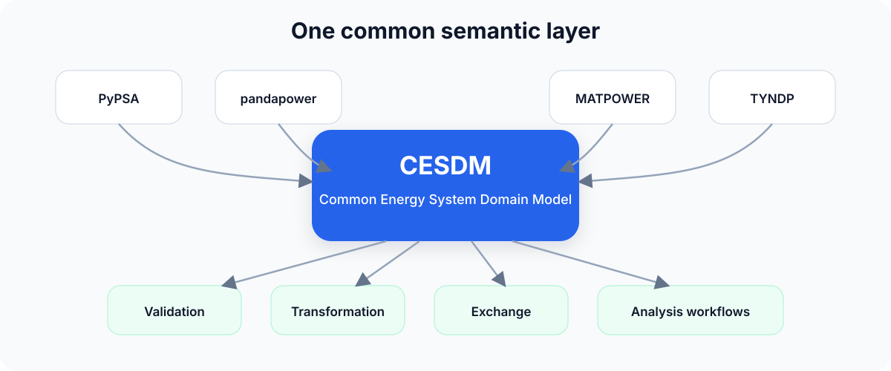
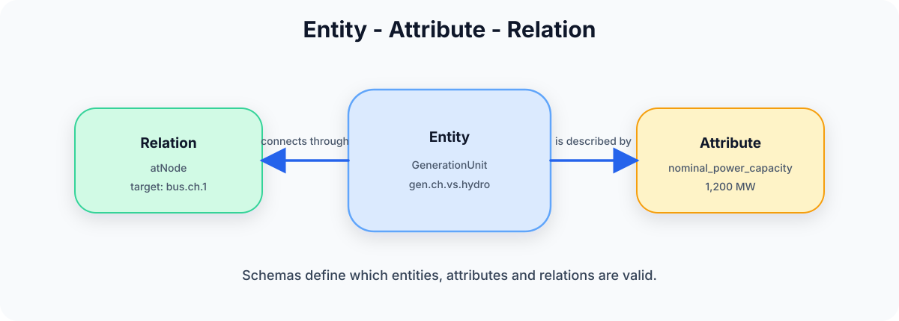

<p align="center">
  
</p>

<p align="center">
  <a href="https://cesdm.github.io/cesdm-toolbox/"></a>
  <a href="LICENSE"></a>
  
</p>

<p align="center">
  <strong>A schema-driven, tool-independent semantic framework for interoperable energy-system modelling.</strong>
</p>

<p align="center">
  Build once · Validate once · Exchange everywhere
</p>

---

## Why CESDM?

Energy-system studies often combine several specialised tools, each with its own data structures, terminology, and assumptions. Moving models between them usually requires custom conversion logic and repeated interpretation of the same physical system.

**CESDM provides a common semantic representation between data sources, modelling tools, and analysis workflows.**

| Principle | What it means |
|---|---|
| **Tool independent** | Describe the system independently of a particular solver or simulation package. |
| **Schema driven** | Define entity classes, attributes, relations, and validation rules in YAML. |
| **Interoperable** | Import, validate, transform, and exchange models across different tools and formats. |
| **Extensible** | Add domain-specific entities and relations without rewriting the generic EAR engine. |

<p align="center">
  
</p>

---

## Core idea

CESDM applies the generic **Entity–Attribute–Relation (EAR)** paradigm to energy systems.

- An **entity** is an object, such as a generation unit, electrical bus, demand unit, or transmission line.
- An **attribute** is a property of an entity, such as `nominal_voltage` or `nominal_power_capacity`.
- A **relation** connects entities, such as `atNode`, `fromNode`, or `hasTechnology`.

Energy-specific semantics live in YAML schemas; the EAR engine itself remains domain independent. Day-to-day Python modelling uses `add_entity`, `add_attribute` and `add_relation`. The [API reference](docs/reference/api.md) lists both that core and the entity proxy (`bus.name = …`, `gen.atNode = bus`).

<p align="center">
  
</p>

---

## Installation

```bash
git clone https://github.com/cesdm/cesdm-toolbox.git
cd cesdm-toolbox

python -m venv .venv
source .venv/bin/activate          # Windows: .venv\Scripts\activate

python -m pip install --upgrade pip setuptools wheel
pip install -e .
```

<details>
<summary>Using <a href="https://docs.astral.sh/uv/">uv</a> or Poetry instead</summary>

```bash
# uv
uv venv
source .venv/bin/activate   # Windows: .venv\Scripts\activate
uv pip install -e .

# Poetry
poetry install
poetry shell
```

</details>

| Optional component | Command |
|---|---|
| PyPSA | `pip install -e ".[pypsa]"` |
| pandapower | `pip install -e ".[pandapower]"` |
| MATPOWER | `pip install -e ".[matpower]"` |
| Jupyter notebook tutorial | `pip install -e ".[jupyter]"` |
| Development tools | `pip install -e ".[dev]"` |
| Everything (toolbox extras) | `pip install -e ".[all]"` |
| FlexECO (separate package) | `pip install -e /path/to/cesdm-flexeco` |

Raw TYNDP and PyPSA files: `python -m tools.download_external_data` writes `external_data/`. How to turn them into CESDM, and where the already converted models are, is in [Use TYNDP and PyPSA data](docs/guides/real-data.md).

---

## Quick start

From the repository root:

```bash
python docs/examples/four-research-groups/run_exchange.py
```

That is the five-minute example: four groups, one Swiss system, written out as CESDM. The walkthrough is [Get started](docs/get-started.md) and [Part 1 of the tutorial](docs/tutorial/index.md). The same exchange, with the power-flow and dynamics layers added, is [Part 2](docs/tutorial/analyses/index.md).

<details>
<summary>Minimal Core EAR snippet (same API the reference script uses)</summary>

```python
from cesdm_toolbox import build_model_from_yaml
from cesdm.default_library import GeneratorTypes

model = build_model_from_yaml("schemas/cesdm")
model.import_library("library/default_library")

model.add_entity("EnergySystemModel", "demo")
bus = model.add_entity("ElectricalBus", "bus.1")
bus.add_attribute("nominal_voltage", 380, unit="kV")

gen = model.add_entity("GenerationUnit", "gen.gas.1")
gen.add_attribute("nominal_power_capacity", 400, unit="MW")
gen.add_relation("atNode", "bus.1")
gen.add_relation("hasTechnology", GeneratorTypes.GENERATION_THERMAL_GAS_CCGT_NEW)

model.validate_or_raise()
print(model.summary())
```

</details>

---

## What CESDM provides

- Schema-driven construction and validation (EAR + Proxy API)
- Reusable libraries: `library/default_library/` and optional `library/tyndp_library/`
- Exchange formats: YAML, Frictionless, HDF5 profiles, CSV/Excel, …
- Public tool adapters: PyPSA, pandapower, MATPOWER; TYNDP data import
- Analysis validation profiles (`cesdm` / `tools/validate_analysis.py`)
- Schema extensions (for example the living-lab survey) without rewriting the EAR engine

In-house solvers (e.g. FlexECO) live in **separate adapter packages**, not in this toolbox core.

---

## Import and export

| Interface | In this toolbox |
|---|---|
| YAML / Frictionless / HDF5 profiles | Core exchange |
| PyPSA | Import (`tools/import_pypsa.py`) |
| TYNDP | Import (`examples/example_import_tyndp*.py`) |
| pandapower / MATPOWER | Import and export |
| FlexECO | Separate package, not in this repository |

---

## Examples

| Script | Role |
|---|---|
| [`docs/examples/four-research-groups/run_exchange.py`](docs/examples/four-research-groups/run_exchange.py) | Four groups exchange one Swiss system |
| [`docs/examples/swiss-analyses/`](docs/examples/swiss-analyses/) | The same system through dispatch, power flow and dynamics |
| [`notebooks/run_exchange.ipynb`](notebooks/run_exchange.ipynb) | The four-group exchange, cell by cell |
| [`examples/`](examples/) | PyPSA and TYNDP import, multi-energy, … |

---

## Documentation

| Topic | Link |
|---|---|
| Get started | [docs/get-started.md](docs/get-started.md) |
| The data model | [docs/concepts/energy-model.md](docs/concepts/energy-model.md) |
| Write an adapter | [docs/guides/write-an-adapter.md](docs/guides/write-an-adapter.md) |
| TYNDP and PyPSA | [docs/guides/real-data.md](docs/guides/real-data.md) |
| FAQ · Glossary | [faq](docs/project/faq.md) · [glossary](docs/reference/glossary.md) |

Full site: **[cesdm.github.io/cesdm-toolbox](https://cesdm.github.io/cesdm-toolbox/)**

---

## Repository structure

```text
.
├── ear/                      # Generic EAR engine
├── cesdm/                    # Energy-system domain layer
├── schemas/cesdm/            # YAML schemas
├── library/
│   ├── default_library/      # Carriers, GeneratorTypes, …
│   └── tyndp_library/        # Optional TYNDP vintage technologies
├── tools/                    # CLI utilities, public importers/exporters
├── docs/
│   ├── examples/             # Four groups, and the Swiss analysis chain
│   ├── tutorial/             # Exchange, then dispatch, power flow, dynamics
│   └── guides/               # Data model, adapters, real data, …
├── notebooks/                # Interactive reference tutorial
├── examples/                 # Further runnable examples
├── analysis_profiles/        # power_flow, optimal_dispatch, …
└── typings/                  # Generated editor stubs
```

---

## Project status

This first release establishes a solid and usable foundation for CESDM, while leaving room for further extensions, new use cases and contributions from the community. Pin the toolbox commit or release and the schema version when you share a model.

---

## Contributing

Schema changes, adapters, validation profiles, examples, and docs are welcome. Open an issue before large structural changes. See [`CONTRIBUTING.md`](CONTRIBUTING.md).

---

## License

See [`LICENSE`](LICENSE).
