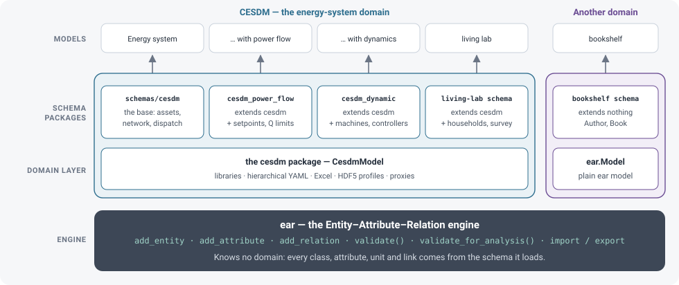

# The EAR engine and CESDM

The three calls of the [previous page](ear.md) — create an object, set a value, link two objects — do not mention energy. That is deliberate. The toolbox is built in layers, and only the upper ones know what a generator is.



## The engine: `ear`

The `ear` package is a generic engine for models made of entities, attributes and relations. It

- **loads a schema**: classes, their inheritance, the attributes and relations each class may have, types, units, limits;
- **builds a model** with `add_entity`, `add_attribute`, `add_relation`, and refuses what the schema does not allow;
- **checks** the whole model with `validate()`, and its completeness for one use with `validate_for_analysis(profile)`;
- **reads and writes** it as YAML, JSON, CSV and Frictionless packages.

It contains no energy classes. Every class, attribute, unit and link comes from the schema it loads. That is what makes the checks trustworthy for exchange: they are the same code for every group, and what they check is written down in the schema, not in anyone's tool. JSON, CSV and Frictionless are read and written here too. A Frictionless package keeps the unit and the provenance of each value in `__unit` and `__provenance_ref` columns. For YAML, this layer has the flat pair only.

The [bookshelf](../use-cases/bookshelf.md) is a model on this engine alone: an `Author`, a `Book`, and `writtenBy`. Its schema extends nothing.

## The energy-system domain: CESDM

CESDM is EAR applied to energy systems. It has two parts.

**The schemas.** `cesdm/schemas/base` defines the energy-system vocabulary: generators, storage, demand, buses, lines, carriers, carrier domains, regions, profiles. Further packages add to it without changing it:

| Package | Adds | Builds on |
|---|---|---|
| `cesdm/schemas/base` | the base: assets, network, dispatch data | — |
| `cesdm/schemas/powerflow` | bus types, setpoints, reactive limits, shunts | the base |
| `cesdm/schemas/dynamics` | machine models, governors, voltage regulators | the base |

Together these three packages are the 59 classes in [Classes and libraries](classes-and-libraries.md#the-classes). How a package adds classes and attributes to another one is explained in [Schemas](schemas.md). The [living-lab case](../use-cases/living-lab.md) is a worked extension: households, a survey, and `ownedBy` on the demand, PV and storage those households point at. In the figure it sits inside the CESDM block, because its schema extends `cesdm/schemas/base`. It is an example package, not a fourth published schema. The bookshelf stands outside that block.

**The `cesdm` package.** `cesdm_toolbox.build_model_from_yaml` returns a `CesdmModel`, which is an `ear` model with what energy work needs on top:

| `CesdmModel` adds | For |
|---|---|
| `import_library`, `GeneratorTypes`, `CarrierDomains`, … | shared technologies, carriers and regions — [libraries](classes-and-libraries.md#libraries) |
| `include_library="referenced"` on export | writing only the library entries a model uses |
| HDF5 profiles | hourly data next to the YAML — [time series](files-and-time-series.md#time-series) |
| Excel import and export | workbooks for inspection and small edits |
| proxies with attribute groups (`gen.dispatch.…`, `gen.power_flow.…`) | shorter scripts — [the proxy API](../guides/proxy-api.md) |
| `get_effective_attribute_value` | a plant's value, or its library technology's when the plant has none |

```python
from cesdm_toolbox import build_model_from_yaml   # returns a CesdmModel

model = build_model_from_yaml("cesdm/schemas/base")
```

Everything an adapter needs — the three calls, `validate()`, `export_yaml`, `import_yaml` — is already in `ear`. A `CesdmModel` uses that same flat pair. The `cesdm` layer makes energy work more convenient; it does not change what a model means.

## Extend CESDM, or start a new schema?

| Your data | Use |
|---|---|
| energy assets, networks, carriers — even with study-specific fields | `cesdm/schemas/base`, with your own [extension package](schemas.md#extending-without-forking) for the extra fields |
| something new that points at energy assets — households owning PV, a survey of their owners | an extension of `cesdm/schemas/base`, as the [living-lab case](../use-cases/living-lab.md) does |
| a domain of your own, with no energy assets | a schema that does not extend `cesdm/schemas/base`, loaded with `ear.build_model_from_yaml`, as the [bookshelf](../use-cases/bookshelf.md) does |

The first two keep you inside CESDM: a model can still be exchanged with every group that loads the same packages. The bookshelf does not. It uses the same engine, and it is not a CESDM model.
