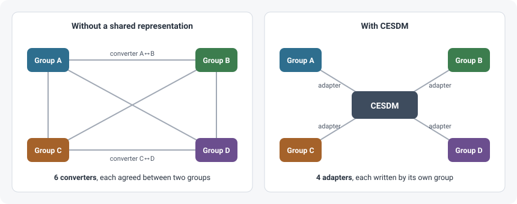

# Why CESDM

The [home page](../index.md) states the problem in one scenario: four research groups model the same system, each in its own representation, and want to exchange their models. This page takes the argument further: what a shared representation saves, what else it gives you, and where it stops.

## Converters or adapters

Without a shared representation, every pair of groups that wants to exchange needs a converter between their two representations. Each converter is written by one group, has to be understood by the other, and breaks when either representation changes.

| Groups | Pairwise converters, *n(n−1)/2* | Adapters to CESDM, *n* |
|---|---|---|
| 2 | 1 | 2 |
| 4 | 6 | 4 |
| 6 | 15 | 6 |
| 10 | 45 | 10 |

For a single exchange between two groups, a direct converter is quicker. The adapter pays off from the third group on, and as soon as exchanges repeat. A new group writes its own adapter and can exchange with everyone else at once; nobody else has to change anything.

The number of converters is only half of the argument. A converter encodes the conventions of two groups: what `Typ = 6` means, that `cap_gw` is in GW, that a reservoir is part of a plant. Nobody else can check those conventions. An adapter writes them down once, against an agreed vocabulary, and the result is checked by the schema before it leaves the group.

## What else you gain

| | What it means for a research group |
|---|---|
| **Your representation can change** | When you restructure your files or your tool renames its fields, you update your adapter. Your partners' adapters and the files already exchanged stay as they are. |
| **The sender checks** | A wrong unit, a code nobody translated or a link to nothing is found before the file is sent, not by the receiver months later. See [Validation](validation.md). |
| **Two models can be compared** | Once both are in CESDM, two groups can compare their inputs object by object, in the same units. [Tutorial, step 2](../tutorial/2-check.md#do-the-four-groups-describe-the-same-system). |
| **Every value keeps its source** | An attribute can carry a [provenance](energy-model.md#provenance) reference, so a merged or forwarded model still says where each number came from. |
| **The file still means something later** | A CESDM file describes the system in an agreed vocabulary, independent of the tool and file layout used at the time. You can read it again in five years. |
| **Extensions do not fork the core** | A study that needs more than the core vocabulary adds its own [schema package](schemas.md#extending-without-forking). Everything else stays shared. |

## One system, several analyses

The same assets carry the data for different analyses. A hydro unit has a capacity and a cost for dispatch, setpoints and reactive limits for power flow, a machine model and controllers for a dynamic simulation. In CESDM, these are values on the **same object**, not three models that have to be kept in sync.

| Analysis | What it adds to the same assets |
|---|---|
| Dispatch | capacities, efficiencies, costs, demand and inflow profiles |
| Power flow | bus types, setpoints, line impedances, reactive limits |
| Dynamics | machine models, inertia, governors, voltage regulators |

The topology, the capacities and the links are shared by all three. [Part 2 of the tutorial](../tutorial/analyses/index.md) adds dispatch, power-flow and dynamics data to the Swiss system, one layer at a time, and checks after each layer that the model is complete for that analysis.

## What CESDM describes — and what it does not do

CESDM separates three things that tools often mix:

| | Example | Who is responsible |
|---|---|---|
| **The system** | the Swiss plants, their capacities, the grid, the regions | CESDM — described once |
| **What an analysis needs** | costs for dispatch, impedances for power flow | CESDM — values on the same objects, checked by an [analysis profile](validation.md#is-it-complete-for-this-analysis) |
| **Running the analysis** | the optimisation, the load-flow solver, the time-domain simulation | your tools — outside CESDM |

CESDM is not a solver and does not replace your tool's own data structures. It is the checked representation *between* groups and tools. The schema also contains classes for **results** — dispatch schedules, power flows, voltages — so that results can be stored next to the system they were computed on and compared across groups. Computing them is the job of your tools.

The file format is a separate question again. YAML keeps provenance and the unit that was written. A Frictionless package does the same, with a unit column, a provenance column, and a separate table for relation targets. See [Files](energy-model.md#files).

## How it is built

CESDM is two things on top of each other:

- the **EAR engine** (`ear`), which knows how to create objects, set values, link objects and check all of it against a schema — for any domain;
- the **energy-system vocabulary**: the CESDM schemas, which define generators, buses, storage, carriers and regions, plus the `cesdm` package with libraries and energy-specific file formats.

The next pages explain this from the bottom up: [Entity, attribute, relation](ear.md) — [The EAR engine and CESDM](engine.md) — [Schemas](schemas.md) — [Validation](validation.md) — [The energy data model](energy-model.md).
