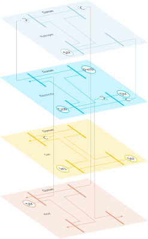
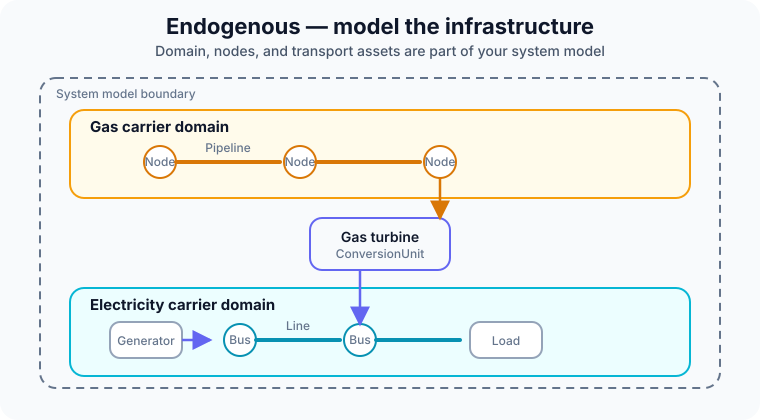
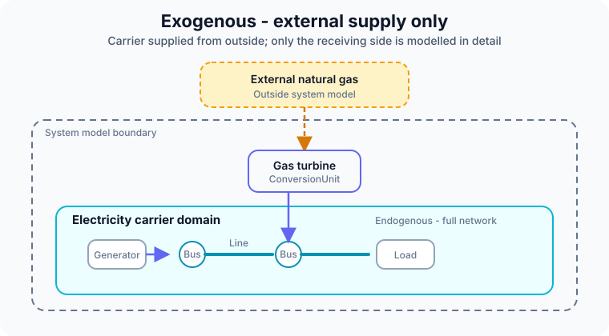

# Carrier domains

Electricity, gas, heat and hydrogen each move through their own infrastructure. In CESDM each of these is a **carrier domain**. Inside a domain, assets transport, inject, withdraw or store one carrier. Between domains, only **conversion units** move energy — a gas turbine, a heat pump, an electrolyser.

| Role | Classes | Attached with |
|---|---|---|
| Domain | `CarrierDomain` (`domain.electricity`, `domain.gas`, …) | — |
| Node in a domain | `ElectricalBus`, `GasBus`, `HeatBus`, `HydrogenBus` | `belongsToCarrierDomain` |
| Transport | `TransmissionLine`, `GenericInterconnector`, … | `fromNode` / `toNode`, or `fromRegion` / `toRegion` in a zonal model |
| One-port asset | `GenerationUnit`, `DemandUnit`, `StorageUnit`, `ExternalSupply`, … | `atNode`, or `belongsToGeographicalRegion` in a zonal model |
| Between domains | `CHPUnit`, `HeatPumpUnit`, `ElectrolyserUnit`, `BoilerUnit`, `FuelCellUnit`, … | one node per carrier, e.g. `atFuelNode`, `atElectricityNode`, `atHeatNode` |

A typed bus fixes its domain: an `ElectricalBus` always belongs to `domain.electricity`.

## Model a network, or only its supply

Not every carrier needs a network in your study. That is a choice of system boundary, not of physics.

=== "Endogenous"

    The domain's nodes and assets are part of the model.

    

=== "Exogenous"

    The carrier comes from outside the boundary; only the receiving side is modelled.

    

| Study | Gas or heat network? |
|---|---|
| Electricity-only capacity expansion | no — fuel is exogenous at gas and CHP units |
| Sector-coupled dispatch | often yes |
| European scenario, TYNDP-style | mixed |

When in doubt: electricity endogenous, everything else exogenous, and widen the boundary only when the study needs it.

For exchange, the boundary is part of the hand-over: a group that receives a model with exogenous gas knows it cannot ask that model about gas flows.

A worked multi-carrier example with heat pump, electrolyser, boiler, fuel cell and CHP: `examples/example_conversion_units.py`.
