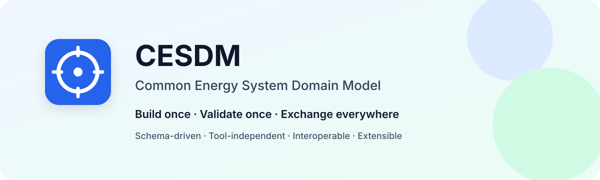
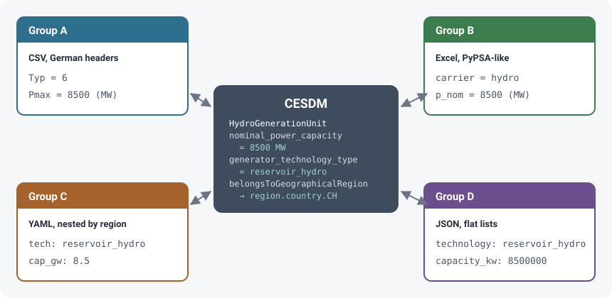

---
hide:
  - navigation
---

# CESDM - Common Energy System Domain Model



## What is CESDM?

**The Common Energy System Domain Model lets research groups exchange their energy-system models — each group keeps its own tool and its own representation.**

Consider the following situation: four research groups have independently developed a model of the same energy system and would like to subject it to the same analysis for intercomparison. One internally keeps the model data in CSV with German headers and technology codes, one in an Excel workbook with a PyPSA-like format, one in nested YAML containing regional technology capacities in GW and TWh, and one as a flat JSON list with capacities given in kW.

Without a standard representation of the system, exchanging data between the four research groups is a time-consuming and error-prone process, requiring either manual inspection and editing during every exchange, developing and maintaining six converters (one per pair), or imposing one group's tools and data structure on every other participant for the duration of the collaboration.



CESDM aims to provide an open, reusable and community-curated standard representation of energy system models to make such exchanges seamless while allowing every group to continue using their own tools and representation. Each research group needs only to independently develop and maintain a single CESDM adapter per model, after which exchanges can take place freely with all others making use of the same standard.

CESDM achieves this by providing a pre-defined schema specifying the model components (entities), their attributes and the relations between them that must be given in order for the exchange to be successful. As an open-source initiative, the core CESDM schema is open to contribution, and can easily be extended to fit specific but temporary needs.

## Common problems addressed by CESDM

| Problem during model exchange | What CESDM does about it |
|---|---|
| Internal codes, column names and nomenclature only the sender understands (`Typ = 6`, `E_Jahr`) | Meaning is made explicit: a code becomes an agreed category on the plant (`reservoir_hydro`, and likewise `ccgt`, `nuclear`, …). The groups share that vocabulary. They do not have to point at a library technology. |
| Units of measurement differ and get lost, or are never specified (MW, GW, kW; GWh, TWh) | Every value must carry a valid unit of measurement; a wrong unit is rejected when it is set. |
| Otherwise equivalent models are structured differently (for example a reservoir has its own dedicated table, or is specified as part of a plant) | There is one common structure; each group's adapter maps to and from that structure. |
| Conventions are often implicit and one may not be aware of them. | Conventions must be made explicit in the adapter code to produce a valid CESDM model. |
| The receiver must validate the sender's data (often in an unfamiliar format) for mistakes — wrong units, unknown codes, broken links | The sender validates their data against the schema before sending. |
| Determining the equivalence of two models is difficult, both parties must become familiar with each others' tools and model structure | Two CESDM files can be compared entity by entity in a common representation. |
| Every new partner means additional complexity, coordination, and work developing and maintaining adapters for everyone. | The new group develops and maintains their own adapter before joining, little to no additional effort required from the others. |

## What it looks like in practice

```text
1 · Each group writes its system as CESDM
    Group A  group-a-csv                  → group_a.yaml   ✓ valid CESDM
    Group B  switzerland_dispatch.xlsx    → group_b.yaml   ✓ valid CESDM
    Group C  system.yaml                  → group_c.yaml   ✓ valid CESDM
    Group D  network.json                 → group_d.yaml   ✓ valid CESDM
2 · Do the four groups describe the same system?
    A vs B: 0 differences
    A vs C: 0 differences
    A vs D: 0 differences
5 · Round trip A → C → A
    0 differences
6 · Every group to every other group
    12 of 12 exchanges preserve the system
```

This is the result of a CESDM implementation of the scenario described above, it can be obtained by [installing CESDM and running the provided example](get-started.md) (about 5 minutes to set up, a few seconds to run).  To read more about what happens during every step of the process, head over to [Part 1 of the tutorial](tutorial/index.md).

Apart from exchange of model data, the CESDM representation can also carry the data for different types of analysis — dispatch, power flow, dynamics — on the same assets. [Part 2 of the tutorial](tutorial/analyses/index.md) shows how this works, and how one can check that a model is complete for each. Ready-made CESDM versions of the [TYNDP 2024 scenarios and a PyPSA network](guides/real-data.md) are available for download.

## How it works

A CESDM model is made of three things: **entities** (a plant, a basin, a region), their **attributes** (a capacity of 8500 MW) and the **relations** between them (the plant draws from the basin, lies in Switzerland). This Entity–Attribute–Relation pattern — EAR — is handled by a generic engine, the `ear` package, which builds a model from these three calls and checks it against a schema. The engine knows no energy at all; CESDM is the energy-system vocabulary on top of it: the schemas that define generators, storage, buses and regions, plus libraries and file formats for energy work. The same engine can describe other domains with a schema of their own. The [bookshelf](concepts/ear.md#a-schema-that-is-not-energy) is a small one: an author, a book, and the link between them.


[Concepts](concepts/index.md) explains each layer: why a shared representation pays off, what entities, attributes and relations are, how schemas are extended without forking, and the two checks.

## What CESDM is not

CESDM is not a solver and does not replace your tool's own data structures. It is the shared, checked representation *between* groups and tools. For CIM/CGMES, ESDL and frameworks like oemof, see [related work](project/related-work.md).

## Start

1. [Install and run the example](get-started.md) — 5 minutes.
2. [Follow the four groups step by step](tutorial/index.md) — 20 minutes.
3. [Understand the concepts](concepts/index.md) — entities, attributes, relations; the EAR engine; schemas.
4. [Write the adapter for your own representation](guides/write-an-adapter.md).

!!! note "Version"
    Toolbox **1.0.0**, schema **1.0.0**. The schema is three folders: `schemas/cesdm` (dispatch), `schemas/cesdm_power_flow`, and `schemas/cesdm_dynamic`. When you share a model, pin the toolbox commit and the folders you loaded. See [roadmap and releases](project/roadmap.md).

!!! note "Acknowledgement"
    The CESDM project is part of the [SWEET-CoSi consortium](https://www.sweet-cosi.ch/), funded by the [Swiss Federal Office of Energy (SFOE)](https://www.bfe.admin.ch/bfe/de/home/forschung-und-cleantech/foerderprogramm-sweet.html) through its [SWEET programme](https://www.bfe.admin.ch/en/general-information-sweet). [Acknowledgement](project/acknowledgement.md).
