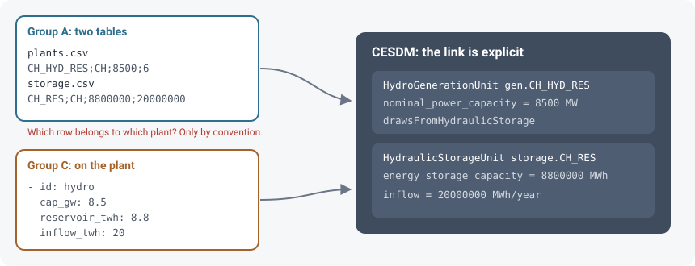

# 1. Writing adapters

An adapter is a piece of code that translates between one group's representation and CESDM, in this section we will walk through Group A's: `adapter_a.py`. The same steps, cell by cell, are in `notebooks/adapter_a.ipynb`. To avoid multiple (potentially conflicting) sources of information, we recommend that this is the only place where a group's internal conventions are written down. As the core functionality that an adapter script has to provide is conversion between the group's tools and files and CESDM, two functions need to be implemented:

- `to_cesdm` reads the group's own files and writes CESDM objects.
- `from_cesdm` reads CESDM objects and writes the group's own files.

## Defining the conceptual mapping

Before writing any code, Group A needs to write down what each piece of its data means in CESDM (see [Entity, attribute, relation](../concepts/ear.md), [classes and libraries](../concepts/classes-and-libraries.md) and the [schema reference](../reference/schema-reference.html) for details). Some columns may become values with a unit, while others may become links to other objects. Let's see what Group A came up with:

| Group A | Meaning | In CESDM |
|---|---|---|
| a row in `plants.csv` | a power plant | a generation entity |
| `Region = CH` | located in Switzerland | link `belongsToGeographicalRegion` → `region.country.CH` |
| `Typ` | which technology | attribute `generator_technology_type` (`2` → `nuclear`) |
| `Eta` | conversion efficiency | `energy_conversion_efficiency`, fraction (÷ 100) |
| `VarKosten` | variable operating cost | `variable_operating_cost`, MU/MWh |
| `Pmax` | installed capacity | `nominal_power_capacity`, MW |
| a row in `storage.csv` | energy and inflow of a hydro plant | a storage entity, linked from that plant |
| `E_Jahr` | annual demand | `DemandUnit` with `annual_energy_demand`, **MWh/year** (× 1000) |

## Converting the group's representation to CESDM

Once this conceptual work is done, the mapping above can be translated into code (see `adapter_a.py` and the [API reference](../reference/api.md)). It is helpful to define some data structures within the adapter code that one can refer to and reuse multiple times:

```python
# --- The mapping tables: one row per code, used in both directions --------
REGIONS = {"CH": ("region.country.CH", "Schweiz")}

# The code names the group's own technology. It is not a library GeneratorType:
# efficiency and variable cost come from the row.
TYP = {
    1: "ccgt",
    2: "nuclear",
    3: "wind",
    4: "solar",
    6: "reservoir_hydro",
    7: "run_of_river",
}
RESERVOIR, RUN_OF_RIVER = 6, 7
TECH_TO_TYP = {tech: typ for typ, tech in TYP.items()}
REGION_TO_CODE = {cesdm: code for code, (cesdm, _) in REGIONS.items()}

_KLASSE = {
    "wind": "WindGenerationUnit",
    "solar": "SolarGenerationUnit",
}
_GENERATOR_CLASSES = (
    "GenerationUnit", "WindGenerationUnit", "SolarGenerationUnit", "HydroGenerationUnit",
)
```

Within `to_cesdm`, each column from the conceptual table created previously is translated into one of three calls: `add_entity`, `add_attribute` or `add_relation`. Demand is the simplest case here. One row of `load.csv` becomes one `DemandUnit`, one `belongsToGeographicalRegion` relation, and one `annual_energy_demand` attribute. `E_Jahr` is given in GWh/year, so the value is multiplied by 1000 before it is stored. As seen at the start of the definition of `to_cesdm`:

```python
def to_cesdm(folder: Path, model) -> None:
    for row in _read(folder / "load.csv"):
        region = REGIONS[row["Region"]][0]
        eid = f"demand.{row['Region']}"
        model.add_entity("DemandUnit", eid)
        model.add_relation(eid, "belongsToGeographicalRegion", region)
        model.add_attribute(eid, "annual_energy_demand", float(row["E_Jahr"]) * 1000,
                            unit="MWh/year", provenance_ref=SOURCE)  # GWh -> MWh
```

A power plant is defined similarly, however the class need not always be the same for every generator: a dedicated subclass is available for wind, PV and hydro, while everything else is a generic `GenerationUnit`. As above, we link the entity to a region using a relation and define some attributes, such as capacity, category, efficiency and variable cost:

```python
for row in _read(folder / "plants.csv"):
    typ = int(row["Typ"])
    region = REGIONS[row["Region"]][0]
    art = TYP[typ]
    eid = f"gen.{row['ID']}"
    if typ in (RESERVOIR, RUN_OF_RIVER):
        model.add_entity("HydroGenerationUnit", eid)
    else:
        model.add_entity(_KLASSE.get(art, "GenerationUnit"), eid)
    model.add_relation(eid, "belongsToGeographicalRegion", region)
    model.add_attribute(eid, "nominal_power_capacity", float(row["Pmax"]),
                        unit="MW", provenance_ref=SOURCE)
    model.add_attribute(eid, "generator_technology_type", art)
    # Wind and PV have no fuel conversion, so Eta is left empty.
    if str(row["Eta"]).strip():
        model.add_attribute(eid, "energy_conversion_efficiency", float(row["Eta"]) / 100,
                            unit="fraction", provenance_ref=SOURCE)   # percent -> fraction
    model.add_attribute(eid, "variable_operating_cost", float(row["VarKosten"]),
                        unit="MU/MWh", provenance_ref=SOURCE)         # EUR/MWh, stored as MU/MWh
```

Some differences in data formats are a simple matter of names and units, while others are structural. Group A keeps hydro energy in a second table, and which row belongs to which plant is not made explicit in the data: by convention, in the same region, the row with stored energy belongs to the reservoir plant, the row without stored energy belongs to run-of-river. That (somewhat messy but not uncommonly so) convention is made explicit in the `to_cesdm` code, after which we can add more attributes and relations specific to hydropower, notably we link the `HydroGenerationUnit` to a `HydroReservoir` using the relation `drawsFromHydroReservoir`.



```python
storage = {}
for row in _read(folder / "storage.csv"):
    kind = RESERVOIR if float(row["E_speicher"]) > 0 else RUN_OF_RIVER
    storage[(row["Region"], kind)] = row

...

# inside the loop iterating through plants.csv, after the plant itself has been created:
if typ in (RESERVOIR, RUN_OF_RIVER):
    s = storage[(row["Region"], typ)]
    basin = f"storage.{s['ID']}"
    model.add_entity("HydroReservoir", basin)
    model.add_attribute(basin, "energy_storage_capacity", float(s["E_speicher"]),
                        unit="MWh", provenance_ref=SOURCE)
    model.add_attribute(basin, "annual_natural_inflow_energy", float(s["Zufluss"]),
                        unit="MWh/year", provenance_ref=SOURCE)
    model.add_relation(eid, "drawsFromHydroReservoir", basin)
```

Most importantly, the receiver does not have to deal with any of this and will receive a clean CESDM file that they can easily translate to their own format. Below we present some other quirks in the data formats of other groups and how they are resolved:

=== "Group B"

    B defines energy carriers, not technologies. That `gas` means a combined-cycle plant was always an assumption inside Group B; now it is one row of a table, and demand in GWh is multiplied by 1000:

    ```python
    CARRIER = {
        "gas": "ccgt",
        "hydro": "reservoir_hydro",
        ...
    }
    annual_mwh = float(row["demand_gwh"]) * 1000
    ```

=== "Group C"

    C nests the reservoir on the plant, and uses GW and TWh. There is no second table to match:

    ```python
    cap_mw = plant["cap_gw"] * 1000
    energy_mwh = plant["reservoir_twh"] * 1e6
    ```

=== "Group D"

    D's capacities are in kW, and its region code is `CHE`:

    ```python
    REGIONS = {"CHE": ("region.country.CH", "Switzerland")}
    cap_mw = item["capacity_kw"] / 1000
    ```

Full adapters for reference: [A](../examples/four-research-groups/adapter_a.py) · [B](../examples/four-research-groups/adapter_b.py) · [C](../examples/four-research-groups/adapter_c.py) · [D](../examples/four-research-groups/adapter_d.py).


Two more arguments on `add_attribute` are useful for exchange:

- **`unit=`** stores the unit with the value. CESDM rejects units the schema does not allow for that attribute: passing `"GWh/year"` for annual demand fails at once, in Group A's own code, before anything is sent.
- **`provenance_ref=`** records who supplied the value. When models from several groups meet, every number still says where it came from.

## Converting from CESDM to the group's representation

The process of writing `from_cesdm` follows similar procedures as above and may well be easier due to the group's familiarity with their own file format. Here is the definition of `from_cesdm`:

```python
def from_cesdm(model, folder: Path) -> None:
    folder.mkdir(parents=True, exist_ok=True)
    basins = model.get_entities("HydroReservoir")
    plants = []
    for cls in _GENERATOR_CLASSES:
        for eid, gen in model.get_entities(cls).items():
            record = {
                "id": eid.removeprefix("gen."),
                "region": gen.get_relation("belongsToGeographicalRegion"),
                "technology": get_attr_value(gen, "generator_technology_type"),
                "capacity_mw": get_attr_value(gen, "nominal_power_capacity"),
                "efficiency": get_attr_value(gen, "energy_conversion_efficiency"),
                "variable_cost": get_attr_value(gen, "variable_operating_cost"),
            }
            sid = gen.get_relation("drawsFromHydroReservoir")
            if sid:
                basin = basins[sid]
                record.update(
                    storage_id=sid.removeprefix("storage."),
                    storage_mwh=get_attr_value(basin, "energy_storage_capacity"),
                    inflow_mwh_per_year=get_attr_value(basin, "annual_natural_inflow_energy"),
                )
            plants.append(record)
    demand = [
        {"region": unit.get_relation("belongsToGeographicalRegion"),
         "annual_mwh": get_attr_value(unit, "annual_energy_demand")}
        for unit in model.get_entities("DemandUnit").values()
    ]

    codes = sorted({REGION_TO_CODE[p["region"]] for p in plants})
    _write(folder / "regions.csv", ["ID", "Bezeichnung"],
           [[c, REGIONS[c][1]] for c in codes])
    _write(folder / "load.csv", ["Region", "E_Jahr"],
           [[REGION_TO_CODE[d["region"]], zahl(d["annual_mwh"] / 1000)] for d in demand])
    _write(folder / "plants.csv", ["ID", "Region", "Pmax", "Typ", "Eta", "VarKosten"],
           [[p["id"], REGION_TO_CODE[p["region"]], zahl(p["capacity_mw"]), TECH_TO_TYP[p["technology"]],
             zahl(p["efficiency"] * 100), zahl(p["variable_cost"])]
            for p in plants])
    _write(folder / "storage.csv", ["ID", "Region", "E_speicher", "Zufluss"],
           [[p["storage_id"], REGION_TO_CODE[p["region"]], zahl(p["storage_mwh"]),
             zahl(p["inflow_mwh_per_year"])]
            for p in plants if "storage_id" in p])
```

## Testing the adapter code

Using the adapter code is quite straightforward:

```python
adapter_a.to_cesdm(Path("group-a-csv"), model)    # CSV  → CESDM
adapter_a.from_cesdm(model, Path("back-to-a"))    # CESDM → CSV
```

The CESDM files are written in human-readable YAML format and can be readily inspected to check that everything is correct:

```yaml
DemandUnit:
  demand.CH:
    attributes:
    - {id: annual_energy_demand, value: 58000000.0, unit: MWh/year, provenance_ref: group-a}
    relations:
    - {id: belongsToGeographicalRegion, target_entity_ids: [region.country.CH]}
```

```yaml
GenerationUnit:
  gen.CH_NUC:
    attributes:
    - {id: nominal_power_capacity, value: 3000.0, unit: MW, provenance_ref: group-a}
    - {id: generator_technology_type, value: nuclear}
    - {id: energy_conversion_efficiency, value: 0.33, unit: fraction, provenance_ref: group-a}
    - {id: variable_operating_cost, value: 9.0, unit: MU/MWh, provenance_ref: group-a}
    relations:
    - {id: belongsToGeographicalRegion, target_entity_ids: [region.country.CH]}
```

Converting files from CESDM to the original format is another useful sanity check:

```text
load.csv
Region;E_Jahr
CH;58000
```

```text
plants.csv
ID;Region;Pmax;Typ;Eta;VarKosten
CH_GAS;CH;400;1;58;45
CH_NUC;CH;3000;2;33;9
CH_WIND;CH;100;3;;0
CH_PV;CH;6500;4;;0
CH_HYD_RES;CH;8500;6;90;0
CH_HYD_ROR;CH;4000;7;90;0
```

```text
storage.csv
ID;Region;E_speicher;Zufluss
CH_RES;CH;8800000;20000000
CH_ROR;CH;0;16000000
```

**Next:** [Validation of CESDM files](2-check.md).
