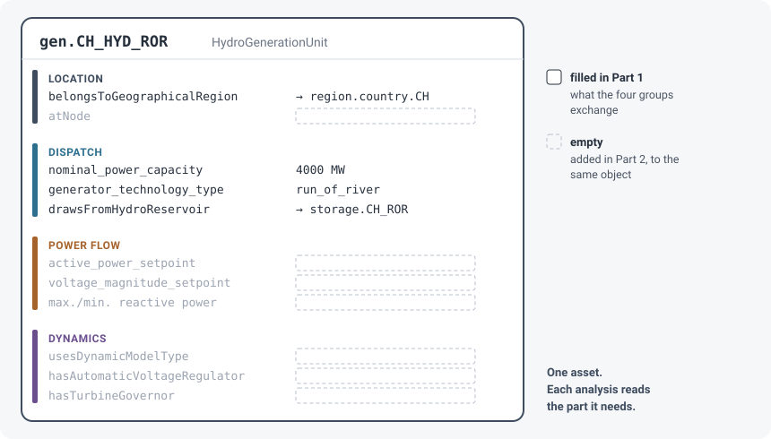

# Part 2: Multiple analyses on the same data

In [Part 1](../index.md), four groups ran the *same* analysis on the same Swiss system and exchanged it between four representations. Part 2 keeps the system and changes the question: what if the system is to be used for *different* analyses — an hourly dispatch, a power flow, a dynamic simulation?

## One asset, several analyses

Each analysis looks at a different side of the same physical plant. An annual dispatch needs its capacity and technology. An hourly dispatch also needs the shape of demand, of wind and PV, and of inflow. A power flow needs the node it is connected to and its active-power setpoint. A dynamic simulation needs a machine model and its controllers.

In CESDM, all of this sits on **one object**. Nothing is described twice, and the parts do not get in each other's way: a dispatch tool reads what it needs and ignores the rest.

After Part 1, the Swiss system has what the four groups need: location by region, capacity, technology, water. The hourly shapes, the power-flow data and the dynamics data are empty. Part 2 fills them in, layer by layer, on the same objects. Each step writes its own file under `output/swiss-analyses/`, and that file is the previous one plus the new layer: `system.yaml`, then `dispatch.yaml`, then `power_flow.yaml`, then `dynamics.yaml`. The hourly numbers sit once, in `profiles.h5` next to those files. CI rebuilds the chain; the files are not part of the repository.

Dispatch loads `cesdm/schemas/base`. The power-flow step loads `cesdm/schemas/powerflow`, which brings the base with it, so `powerflow_bus_type` and line impedance can be set. The dynamics step loads that folder together with `cesdm/schemas/dynamics`, so the machine types and controllers exist and the network fields from the previous file still validate.

## What each analysis asks for

The toolbox ships one **analysis profile** per type of analysis. A profile lists, per class, what must be present. This table is generated from the profiles themselves (`requirements_table.py`), for the classes of the Swiss system:

| Class | Attribute or link | `optimal_dispatch` | `power_flow` | `dynamics` |
|---|---|---|---|---|
| `GenerationUnit` and subclasses | `hasTechnology` | if `not generator_technology_type` | | |
| | `generator_technology_type` | if `not hasTechnology` | | |
| | `nominal_power_capacity` | required | | |
| | `atNode` | if `not belongsToGeographicalRegion` | required | |
| | `active_power_setpoint` | | required | |
| `WindGenerationUnit`, `SolarGenerationUnit` | `hasAvailabilityProfile` | required | | |
| | `annual_resource_potential` | required | | |
| `HydroGenerationUnit` | `annual_resource_potential` | if `not drawsFromHydroReservoir` | | |
| `HydroReservoir` | `energy_storage_capacity` | required | | |
| | `hasNaturalInflowProfile` | if `annual_natural_inflow_energy > 0` | | |
| `DemandUnit` | `annual_energy_demand` | required | | |
| | `hasDemandProfile` | required | | |
| | `atNode` | if `not belongsToGeographicalRegion` | required | |
| | `active_power_demand` | | required | |
| `ElectricalBus` | `nominal_voltage`, `powerflow_bus_type` | | required | |
| `TransmissionLine` | `fromNode`, `toNode` | required | required | |
| | `thermal_capacity_rating` | required | | |
| | `series_resistance_per_km`, `series_reactance_per_km`, `line_length` | | required | |
| `DynamicMachineModelType.Synchronous` | 10 machine parameters, e.g. `inertia_constant` | | | required |
| `Controller.AVR.*`, `.GOV.*`, `.PSS.*` | the parameters of each controller model | | | required |

Three things stand out:

- **Place depends on the analysis.** The power-flow profile always wants `atNode`. The dispatch profile wants it only when the unit has no region, so the Swiss system, which is zonal, does not need a bus for an hourly dispatch.
- **Some requirements are conditional.** A storage needs an hourly inflow profile only *if* it has inflow at all; a hydro unit needs its own resource potential only *if* it does not draw from a storage. Profiles express this with `when:`.
- **Dynamics asks about other objects.** Its requirements are on machine models and controllers, which are separate objects linked from the generator. Nearly every parameter in that column also has a schema default, and the check accepts the default, so the column overstates what you must supply. [The dynamics layer](4-dynamics.md) shows what is actually tested.

Run it yourself, for any classes: `python docs/examples/swiss-analyses/requirements_table.py GenerationUnit DemandUnit`.

## The steps

| Step | What happens | Analysis |
|---|---|---|
| [1. Correct is not complete](1-complete.md) | `validate()` passes. Completeness is a second check, one profile per analysis. | the two checks |
| [2. The dispatch layer](2-dispatch.md) | The annual balance is already complete. The hourly profile is not, until a stylised year is added on the same plants. | dispatch |
| [3. The power-flow layer](3-power-flow.md) | One winter evening: buses, corridor lines and setpoints on the same plants. An AC power flow in pandapower. | power flow |
| [4. The dynamics layer](4-dynamics.md) | Machine models and controllers are separate objects. The shipped profile checks them only once they exist, and it accepts schema defaults. | dynamics |

!!! info "A stylised system"
    The Swiss system shows the mechanics. Step 2 is a stylised hourly year, not a weather year. Step 3 is one winter evening on a stylised 380 kV network, not the Swiss transmission grid. Step 4 uses a 6th-order subtransient model, with typical round-rotor parameters for the steam and gas units and salient-pole parameters for hydro. A benchmark with textbook-verifiable data is the [Kundur use case](../../use-cases/kundur.md).
